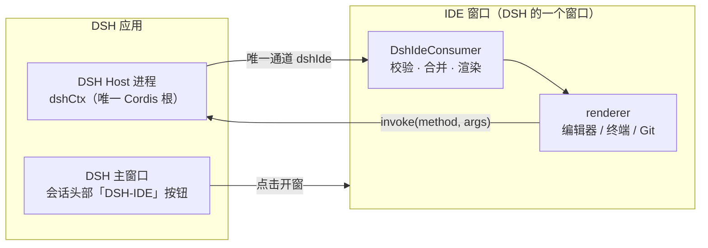
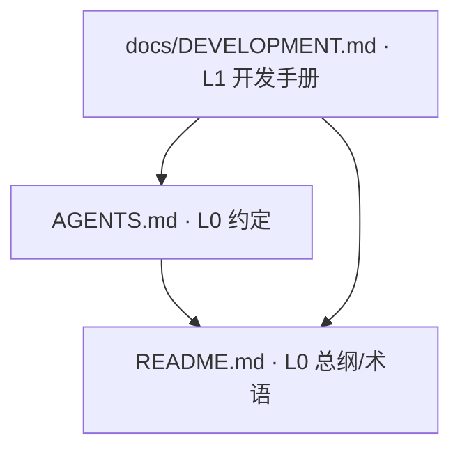

# DSH-IDE

[](CHANGELOG.md)
[](LICENSE)
[](https://github.com/deepseek-ai)
[](NOTICE.md)

> **把 VS Code 装进 DeepSeek-Harness：一个应用、一个工作区、一套 AI 状态。**

> 本文是仓库总纲：定义项目、统一术语、权威层级、文档索引与状态入口。全部规格内容由 `docs/DEVELOPMENT.md` 唯一承载，本文不重复其内容。

---

## 1. 项目概述

### 1.1 这个插件是什么

DSH-IDE 不是「又一个 AI 编辑器」，而是把 **整个 VS Code 桌面运行时改造成 DeepSeek-Harness 的一个 bundle 插件**。

装上它之后：

- **左侧是完整的原生 IDE** —— 编辑、终端、Git、调试、扩展市场、远程开发，全部是 VS Code 1.143.1 的真实能力，不是重新实现的仿制品。
- **AI 就在同一个工作区里** —— DSH 作为唯一 AI 内核驱动侧栏；它能读你正在改的文件、调用真实工具、走审批流程、并行多会话。
- **没有第二套状态** —— 不存在「IDE 一套会话、AI 一套会话」，也没有第二个协议、第二个 Cordis 根。

一句话：**DSH 负责思考，VS Code 负责编辑，两者共用同一个工作区和同一份会话真源。**

#### 它解决了什么问题

| 常见痛点 | DSH-IDE 的做法 |
| --- | --- |
| AI 编辑器与本地工作区割裂，AI 看不到真实上下文 | AI 直接运行在 DSH Host 里，通过官方通道读取同一工作区与会话 |
| 「AI 版编辑器」往往是重做的简化编辑器，缺终端/调试/扩展 | 直接复用完整 VS Code 运行时，能力不打折 |
| 桌面 AI 应用和编辑器是两个程序，状态两头对不上 | 插件跑在 DSH 应用内，IDE 窗口是 DSH 的一个窗口，天然一体 |
| 各家 AI 插件协议各不相同，难以审计 | 只有一条 `IServerChannel`（token `dshIde`）+ 中立 DTO，边界可验证 |

#### 关键特性

- **原生 IDE 体验**：完整编辑器、集成终端、Git、调试器、扩展市场、远程连接
- **AI 侧栏由 DSH 驱动**：会话、模型选择、工具调用、权限审批、问卷交互全部归 DSH
- **单一通道**：IDE ↔ DSH 只走 `dshIde` 通道，双向校验、版本连续、fail-closed
- **统一外观**：账号入口读取 DSH 登录态并显示头像与昵称；界面收敛为一处账号入口与一处设置入口
- **可回滚的构建**：唯一交付物是 `dist/dsh-ide-2.0.0.tgz`，由官方脚本 `gulp dsh-ide-pack` 产出

#### 架构一览



AI 能力全部留在 DSH 一侧；IDE 侧只消费中立 DTO，不持有 `dshCtx`、不复制会话状态。

#### 安装

DSH-IDE 以 **DSH bundle 插件**形式交付，不提供独立安装包。

```bash
# 1. 构建（仓库根执行；产出 dist/dsh-ide-2.0.0.tgz）
npm install
npx gulp dsh-ide-pack

# 2. 在 DSH 中安装该插件包，然后重启 DSH
```

安装后，在 DSH 主窗口会话头部点击「DSH-IDE」按钮即可打开原生 IDE 窗口。

> 构建详情、依赖与原生模块 ABI 要求见 [`docs/DEVELOPMENT.md`](docs/DEVELOPMENT.md) 第 8 章；版本变更见 [`CHANGELOG.md`](CHANGELOG.md)。

---

### 1.2 项目定义

**为什么做**：DSH（DeepSeek Harness）是本地 AI 内核，具备会话、模型、工具、审批、语音能力，但缺少成熟的桌面编辑器外壳；普通 AI 编辑器又把 AI 与工作区割裂成两套状态。DSH-IDE 把两者合成**一个 DSH 应用**、一个工作区、一套状态（IDE 是 DSH 应用内的拓展，不是另一个 app）。

**想做成什么效果**：把整个 IDE 改造成 DeepSeekHarness 的插件——整个 DSH-IDE 项目打包后就是**一个** DSH bundle 插件（`dsh-ide@2.0.0`，产物 `dist/dsh-ide-2.0.0.tgz`），由 DSH 加载后提供原生 VS Code 的编辑、终端、Git、调试、扩展与远程体验；AI 侧栏由 DSH 驱动，能基于真实工作区上下文调用工具、走审批、多会话并行。不存在独立的 IDE 安装包，也不存在第二套 AI 会话或协议。

DSH-IDE 是把整个 VS Code 桌面运行时改造成 DeepSeekHarness 插件的实现：以 **DeepSeek Harness**（下称 **DSH**）为唯一 AI 内核、以 VS Code 1.143.1 源码树（仓库根，已扁平化）为 IDE 载体，整体作为 DSH 的单一 bundle 插件 `dsh-ide@2.0.0` 交付。改造后的形态满足：DSH-IDE 作为 DSH 应用内的拓展，与 DSH 具**天然一体**关系并共享**唯一一个 Cordis 根** `dshCtx`（它位于 DSH Host 进程，IDE 侧不持有、不复制；见 `docs/DEVELOPMENT.md` 不变量 I1）；IDE 窗口只经**唯一一条 `IServerChannel`**（token `dshIde`）消费 DTO；会话、模型、工具、权限、审批、问卷、设置与语音全部由 DSH 决定。

仓库只有一棵代码树（仓库根；原 `vscode-1.143.1/` 已扁平化到根）。所有 DSH-IDE 源码、资源、构建与验证脚本都落在这棵树的 VS Code 原生分层中，不存在第二个子工程。

许可、商标与上游归属以 [`NOTICE.md`](NOTICE.md) 与 [`LICENSE`](LICENSE) 为准。二者是法律文件，保留原文，不纳入规格文档分层；本文及 `docs/` 不对资质归属作技术性声明。

**法律文件维护规则（旁注，文件本身不改）**：`NOTICE.md` 声明了 VS Code（MIT，原文见 `LICENSE.txt`）与 DSH 两处上游来源、商标归属及许可范围；`LICENSE` 是本仓库 MIT 许可文本。二者**不得重写、不得删改原文**；仅当新增第三方依赖或素材时，才允许在 `NOTICE.md` 末尾**追加**条目，原有内容一字不动。定稿时未新增任何依赖或素材，`NOTICE.md` 保持原文。全量法律/许可文件清单与定稿核验见 [`docs/DEVELOPMENT.md`](docs/DEVELOPMENT.md) 第 7 章 §4。

### 1.3 两种时态（全仓统一用法）

| 时态 | 含义 | 使用位置 |
| --- | --- | --- |
| **交付态** | 目标形态，规范性描述，用「必须 / 定义」表述 | 开发手册各章正文 |
| **当前态** | 截至本版文档的代码实况 | 阶段状态只由开发手册第 3 章 §6 唯一状态表承载；实测记录见第 5 章，实现差距见第 7 章 §3 |

禁止把当前态的骨架行为写成规范，也禁止把交付态契约写成已完成功能。

文档中的「本轮」「定稿时」等**会话过程性表述**统一指 **2026-11-08 文档定稿**这一时点，不构成规范条款；业务流程中的「本次实例 / 本次调用 / 本次决议」指流程实例本身（见 [`docs/DEVELOPMENT.md`](docs/DEVELOPMENT.md) 第 4 章），与时态无关。所有「当前态」记录以定稿时点的代码实况为准；实现推进后按 §4 权威层级更新开发手册，不得就地另立第二份定义。

## 2. 统一术语

下表是全仓唯一术语定义。其它文档只使用这些词，不再另行定义、不另造同义词。

| 术语 | 定义 |
| --- | --- |
| DSH 主窗口 | DSH 桌面端 UI，持有会话头部「DSH-IDE」按钮 |
| IDE 窗口 | 由插件 Host 半身经 Electron 主页启动的 VS Code `BrowserWindow` 及其 renderer；窗口进程与 DSH Host 半身不是同一个 OS 进程，仍属同一 DSH 应用 |
| Electron 主页 | `<plugin>/runtime/electron-home`：插件 Host 半身把 DSH 安装的 Electron（硬链接可执行文件 + 目录联接资源目录）与插件 `runtime/app` 载荷物化到同一启动目录，供原生 IDE 窗口启动 |
| `dshCtx` | DSH Host 进程内唯一的 Cordis 根，DSH 服务的注册与订阅都发生在它上面 |
| 插件 | `build/lib/dsh/package.json` 定义的 `dsh-ide@2.0.0` bundle 插件，入口 `src/vs/platform/dshClient/index.js` |
| 通道 | 唯一 `IServerChannel` 实现 `DshIdeChannel`，token `dshIde`，注册点 `src/vs/code/electron-main/app.ts` |
| 视图宿主 | `IdeViewHost` 窄接口（`open` / `subscribe` / `invoke` / `close`）；当前为 `DshIdeViewService`（投影 + 快照版本计数），DSH 能力经 `DshIdeBackend` 端口由插件 Host 半身注入 |
| 中立事件 | `IdeEvent`，`translator.ts` 输出的与 DSH 内部模型无关的封闭事件联合 |
| 投影快照 | `IdeViewSnapshot`，`ide-view-projector.ts` 折叠出的 `{ rows, version }` |
| 通道快照 | `DshIdeSnapshot`，跨 `dshIde` 通道传输的 `{ wireRevision, channelId, version, state }` |
| 消费者 | `DshIdeConsumer`，IDE renderer 侧校验并消费通道快照的组件（交付态） |
| 调用 | IDE → DSH 的 `invoke(method, namedArgs)`，经通道 `call()` 分发 |
| 订阅 | DSH → IDE 的单向 `listen('snapshot')` 快照流 |
| 门禁 | `build/lib/dsh/verify/dshIdeVerify.mjs` 提供的四条 `verify:dsh-ide-*` 校验 |
| 阶段 | 唯一开发路线中的 P0–P7，见 [`docs/DEVELOPMENT.md`](docs/DEVELOPMENT.md) 第 3 章 |
| 步骤 / 状态 | 唯一业务流程中的 T1–T9 与 ST0–ST4、STF，见开发手册第 4 章 |
| 关键节点 | 阶段出口判据全部满足的时刻 K1–K8，见开发手册第 3 章 |
| 流程实例 | 从一次开窗触发到该窗口关闭（或异常终止）的一次完整业务过程 |

## 3. 文档分层与权威层级

本仓库规格文档只有三份，每份只有一个职责；同一事实只在其职责文件内定义一次，其余文件只能引用。

| 层 | 文件 | 唯一职责 |
| --- | --- | --- |
| L0 总纲 | 本文件 `README.md` | 项目定义、术语、权威层级、状态入口、文档索引 |
| L0 约定 | [`AGENTS.md`](AGENTS.md) | 人与 AI 协作者的工作规则（复用、构建、许可证、提交纪律） |
| L1 手册 | [`docs/DEVELOPMENT.md`](docs/DEVELOPMENT.md) | 架构不变量、接口契约、唯一开发路线、唯一业务流程、验证门禁、仓库结构、资产登记 |
| — 法律 | `NOTICE.md`、`LICENSE` | 法律声明（保留原文，不参与上述分层） |

**定稿声明**：本仓库规格文档由 `README.md`、`AGENTS.md` 与 `docs/DEVELOPMENT.md` 三份构成，2026-11-08 定稿。`docs/` 下仅保留单一开发手册，原 6 份专题文档（`architecture.md` / `ide-channel-protocol.md` / `implementation-plan.md` / `verification.md` / `repo-layout.md` / `cleanup-inventory.md`）已删除，其内容连同原 `DEVELOPMENT.md` 一并整理为 `docs/` 下唯一手册。此后任何变更按 §4 权威层级、§4.1 引用图与删除/合并规则、[`AGENTS.md`](AGENTS.md) §6 的核验约定执行。`NOTICE.md`、`LICENSE`、两份 `PROVENANCE.md` 与 `LICENSE-DSH` 属法律与来源凭据，不参与规格改写。

阅读顺序：本文件 → `AGENTS.md` → `docs/DEVELOPMENT.md`。

## 4. 权威层级与冲突处理

自高到低只有一条链：

```text
代码与门禁脚本 > 契约真源 dshIdeProtocol.ts > 开发手册中职责所属章节 > 其它文档
```

冲突处理规则唯一：以链上更高者为准，并修正较低者的表述；**不得改代码去迁就文档**。任何文档都不得就地另立第二份协议、第二条路线或第二条流程。

### 4.1 引用图规则（防循环定义）

交叉引用分两类，只有第一类参与层级判定：

1. **定义依赖**：各文档头部 blockquote 段中指向权威源的链接。序号固定为 `README.md` → `AGENTS.md` → `docs/DEVELOPMENT.md`；定义依赖边只允许从序号靠后的文件指向靠前的文件，因此该图必须是 DAG（0 环）。
2. **导航 / 参见**：正文与表格中的链接，用于指向唯一定义处、排错与文件定位。允许双向，但**不得复制定义**；不构成定义依赖边。

由此保证：L0 只定义项目、术语、权威层级与状态入口，不承载 L1 的定义内容；L1 引用 L0 术语表是唯一允许的向上引用；每个主题只在开发手册里定义一次。核验脚本口径见 [`docs/DEVELOPMENT.md`](docs/DEVELOPMENT.md) 第 5 章 §10.1。

**定义依赖图（3 节点、3 边，序号单向 ⇒ DAG）**：



图中只画头部 blockquote 段的定义依赖边；导航 / 参见链接不在此图。§3 已有「层 → 文件 → 唯一职责」表，本图不重复职责说明。

**删除 / 合并文档规则**：删除任何文档前，先全仓 `git grep` 该文件名（代码注释、CI、issue/PR 模板、其它文档相对链接），把引用改到迁移后的目标位置；再删文件；最后按 [`docs/DEVELOPMENT.md`](docs/DEVELOPMENT.md) 第 5 章 §10.1 跑四项核验。顺序颠倒会留下断链，断链检查失败。

## 5. 唯一开发路线（摘要）

```text
P0 初始化 → P1 契约 → P2 适配层 → P3 通道与宿主 → P4 消费者与 UI → P5 功能与真机接线 → P6 测试与验证 → P7 打包为 DSH 插件与交付
```

这是全仓唯一路线：严格串行、前一阶段出口判据满足后才可启动后一阶段，无并行阶段、无可选阶段、无回退路径、无替代方案。阶段定义、依赖与出口判据见 [`docs/DEVELOPMENT.md`](docs/DEVELOPMENT.md) 第 3 章，不得在其它文档中重述。

## 6. 唯一业务流程（摘要）

```text
触发（DSH 主窗口点击「DSH-IDE」）→ 开窗与连接 → 订阅 dshCtx 真源 → 翻译 → 投影 → 发布快照 → IDE 消费渲染 → 用户调用回送 DSH（同一流程内迭代）→ 关闭窗口释放连接
```

这是全仓唯一业务流程：一次流程实例对应一个 IDE 窗口，所有用户操作走同一条调用路径，所有状态变化走同一条快照路径。完整步骤、状态流转与异常终止见 [`docs/DEVELOPMENT.md`](docs/DEVELOPMENT.md) 第 4 章。

## 7. 当前状态入口

- 当前阶段与阶段进度（唯一状态表）：[`docs/DEVELOPMENT.md`](docs/DEVELOPMENT.md) 第 3 章 §6；本文不写阶段状态细节。
- 门禁与测试实测、代码实况与残留登记、全局扫描与引用图：开发手册第 5 章 §3–§4、第 7 章 §3 / §7。
- 当前项目情况、待办与完成标记、每轮更新记录：开发手册 §0.1、第 7 章 §3 / §7.7（每轮改动收尾回写）。
- 真机验证由用户执行；本轮用户操作清单：开发手册 §0.2（AI 每轮只整理该清单，不代跑、不推断观测结果）。

## 8. 硬边界

硬边界是四条不变量，由 [`docs/DEVELOPMENT.md`](docs/DEVELOPMENT.md) 第 1 章 §1 唯一定义并解释。本文不列名称、不解释、不复制；越界即违约，门禁判据见开发手册第 5 章 §3。
