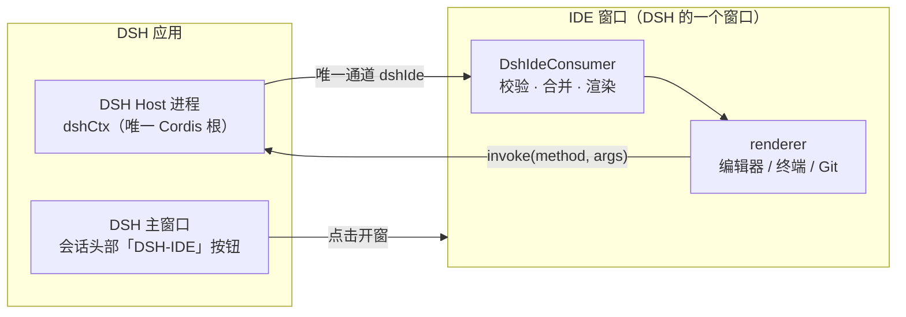

# DSH-IDE

[](CHANGELOG.md)
[](LICENSE)
[](NOTICE.md)

**把完整的 VS Code 桌面体验带进 DeepSeek Harness。**

DSH-IDE 是 [DeepSeek Harness](https://github.com/deepseek-ai)（下称 DSH）的 bundle 插件。它把整个 VS Code 桌面运行时改造成 DSH 的一部分——同一个应用、同一个工作区、同一份会话状态。

---

## 这是什么

DSH 是一个本地 AI 内核，具备会话、模型、工具调用、审批与语音能力，但本身没有成熟的编辑器外壳。DSH-IDE 补上这一块：

- **完整原生 IDE** — 编辑、终端、Git、调试、扩展市场、远程开发，全部是 VS Code 1.143.1 的真实能力，不是重新实现的简化版。
- **AI 与工作区同源** — DSH 作为唯一 AI 内核驱动侧栏，能读你正在改的文件、调用真实工具、走审批流程、并行多会话。
- **没有第二套状态** — 不存在「IDE 一套会话、AI 一套会话」，也没有第二个协议或第二个内核。

一句话：**DSH 负责思考，VS Code 负责编辑，两者共用同一个工作区与同一份会话真源。**

## 功能

| 能力 | 说明 |
| --- | --- |
| 原生 IDE 窗口 | 从 DSH 会话头部一键打开，复用宿主 Electron，插件包不携带第二份 Electron |
| AI 侧栏 | 由 DSH 的 Chat Agent 驱动，内容来自 DSH 会话真源 |
| 模型与推理档 | 输入框内直接切换 DSH 模型目录中的模型与推理等级 |
| 权限预设 | 读取 DSH 权限目录，按预设切换 |
| 智能体预设 | 新会话创建前选择 DSH 智能体预设 |
| 账号入口 | 左下角显示 DSH 登录态的真实头像与昵称 |
| 流式回答 | 支持增量渲染，回答逐字输出 |
| 行内补全 | 由 DSH 后端提供 |

## 系统要求

- **DeepSeek Harness** `>= 0.2.2-rc.1`
- 宿主 DSH 桌面端自带的 Electron（DSH-IDE 不自带 Electron）
- Windows x64 / Linux x64（当前构建目标）

## 安装

DSH-IDE 以 **DSH bundle 插件**形式交付，不提供独立的 IDE 安装包。

```bash
# 1. 构建（仓库根执行）
npm install
npx gulp dsh-ide-pack        # 产出 dist/dsh-ide-2.0.0.tgz

# 2. 在 DSH 中安装该插件包，然后重启 DSH
```

安装完成后，在 DSH 主窗口的会话头部点击「DSH-IDE」按钮即可打开原生 IDE 窗口。

### 构建变体

| 命令 | 产物 | 说明 |
| --- | --- | --- |
| `npx gulp dsh-ide-pack` | `dist/dsh-ide-2.0.0.tgz` | 标准构建，保留源码映射 |
| `CI=1 npx gulp dsh-ide-pack-min` | `dist/dsh-ide-2.0.0.tgz` | minified，剔除 `*.js.map`，体积约 71.6 MiB |

## 架构



AI 能力全部留在 DSH 一侧；IDE 侧只消费中立 DTO，不持有 DSH 上下文、不复制会话状态。

## 仓库结构

```
src/vs/workbench/contrib/dsh/     DSH 集成层（Agent、输入框数据源、模型菜单）
src/vs/workbench/contrib/chat/    Chat 视图与输入框（VS Code 核心，DSH 定制在此）
src/vs/platform/dshClient/        与 DSH 通信的唯一通道
build/lib/dsh/                    打包与验证脚本
build/dsh/chat-render/            聊天渲染 sidecar 及其来源凭据
```

## 构建与开发

```bash
npm install

# 类型检查
node --max-old-space-size=8192 node_modules/typescript/bin/tsc --noEmit -p src/tsconfig.json

# 测试
npm run test-dsh:all

# 打包
CI=1 npx gulp dsh-ide-pack-min
```

> **首次构建提示**：`src/tsconfig.base.json` 把 `electron` 类型映射到 `.build/typings/electron.d.ts`。该文件是构建产物，由 `node --experimental-strip-types build/npm/electronTypes.ts` 从官方下载并按 `build/checksums/electron.txt` 校验。DSH-IDE 不自带 Electron 运行时，只借用宿主提供的类型。

## 贡献

提交前请阅读 [`AGENTS.md`](AGENTS.md)（协作约定与代码风格）。变更请保持：

- 不新增第二个 Cordis 根、第二套会话或第二套协议
- 复用优先：先查 DSH 与 VS Code 是否已有现成实现
- 新增注释用中文，上游既有注释保持原样
- 提交信息写清「做了什么 / 门禁结果 / 未完成项」

## 许可

- 本项目：[MIT](LICENSE)
- 上游归属与商标：[NOTICE.md](NOTICE.md)
- 第三方依赖清单：[ThirdPartyNotices.txt](ThirdPartyNotices.txt)

DSH-IDE 基于 VS Code（MIT）与 DeepSeek Harness 构建，与 Microsoft 及 GitHub 无关联。
