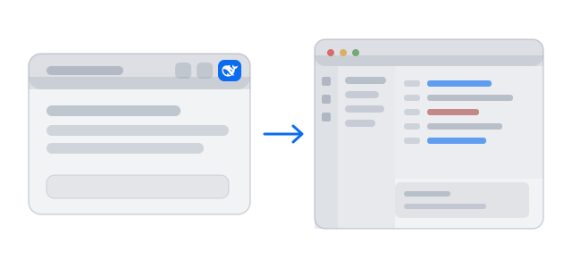

# DSH-IDE

Opens a full VS Code window for the current workspace, reusing the Electron runtime that ships with DeepSeek Harness. The window connects to the same DSH Host over the official client transport, so chat, models, approvals and tools keep running on DSH — there is no second kernel, no second session list, and no second protocol.

## How to open it

Click the **whale button** in the session header, right of the conversation menu (the `…` menu). A new window opens for the same workspace. Clicking again reuses that window instead of opening a second one.

## What you get

- **The real editor** — editing, terminal, Git, debugging, the extension marketplace and remote development are VS Code 1.143.1 itself, not a reimplementation.
- **One AI, one workspace** — DSH stays the only AI kernel. It reads the files you are editing, calls real tools and goes through approvals, all from the sidebar of the window you are already in.
- **Shared session state** — switching sessions in the window switches the DSH session. There is no separate conversation to keep in sync.

## Good to know

- **Windows x64 only.** Materializing the window runtime is implemented for Windows; other platforms report that limitation instead of pretending to launch.
- **The window is disposable.** Closing it does not end your DSH session; reopen it from the whale button.
- **Native modules follow DSH's Electron.** `node-pty` and `ripgrep` are built for the Electron version DSH ships, not for the VS Code version number.
