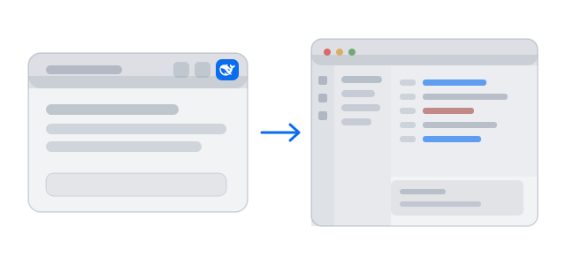

# DSH-IDE

为当前工作区打开完整的 VS Code 窗口，复用 DeepSeek Harness 自带的 Electron 运行时。窗口经官方客户端传输连接同一个 DSH Host，聊天、模型、审批与工具仍由 DSH 提供——没有第二个内核、没有第二套会话列表、也没有第二个协议。

## 怎么打开

点击会话头部的**鲸鱼按钮**（「…」会话菜单右侧）。会为同一工作区打开一个新窗口。再次点击会复用那个窗口，而不是再开一个。

## 你能得到什么

- **真正的编辑器**——编辑、终端、Git、调试、扩展市场与远程开发就是 VS Code 1.143.1 本身，不是简化重写版。
- **一个 AI，一个工作区**——DSH 仍是唯一的 AI 内核。它读你正在改的文件、调用真实工具、走审批流程，全部就在你所在窗口的侧栏里。
- **会话状态同源**——在窗口里切换会话就是切换 DSH 会话，不存在需要另外同步的一份对话。

## 需要知道

- **仅支持 Windows x64。** 窗口运行时的物化只有 Windows 实现；其他平台会明确返回该限制，不会假装已启动。
- **窗口可以随时关掉。** 关闭窗口不会结束 DSH 会话，从鲸鱼按钮重新打开即可。
- **原生模块跟随 DSH 的 Electron。** `node-pty` 与 `ripgrep` 按 DSH 自带的 Electron 版本编译，与 VS Code 版本号无关。
